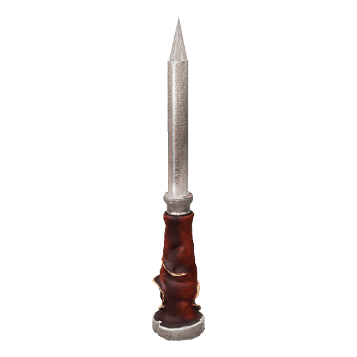
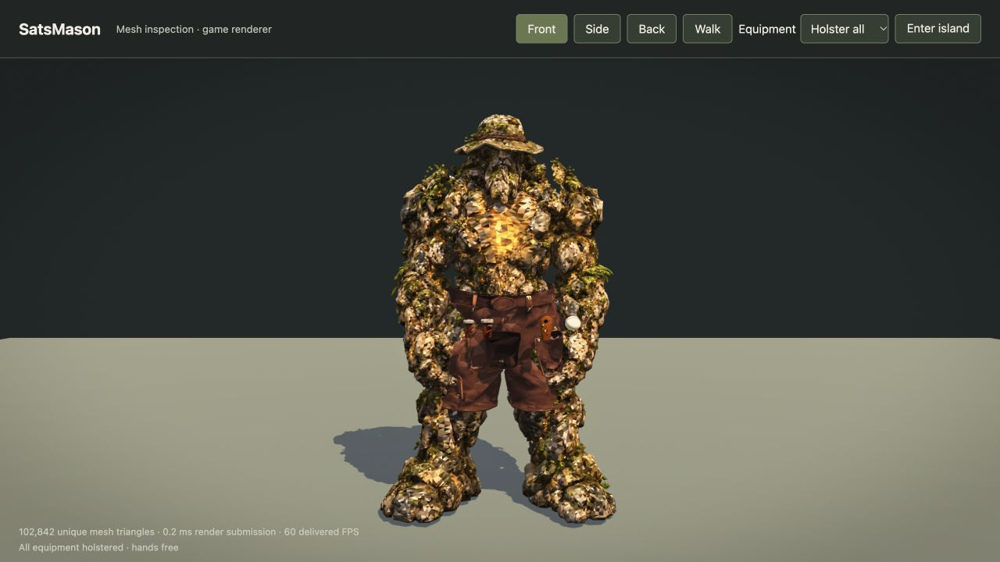

# SatsMason character and pocketed kit

SatsMason is a Tripo stone-and-moss mason with the reviewed hat, beard and exposed BTC chest symbol. A leather waist apron leaves the chest clear. The hammer is removed. Four tools are selectable: hurley, flat chisel, trowel and point chisel, plus Holster all. Stored chisels and trowel expose only their grips; the hurley sits behind the back. Selection persists and bounded equipment messages reach remote players and NPCs. Tools retain the existing melee rules; exact strike animation replication and masonry construction are outside this change.

## Chisel and outline refinement

The replacement Tripo point chisel has a true pointed apex. The previous generated mesh ended in a flat cap. The new mesh is fitted at the same 0.29-unit tool length and keeps the existing leather-pocket attachment. The inspection page also loads the newer renderer's water-shader dependency so it opens on this upstream revision.

The visible stone body is unchanged. The current inspection model contains 102,522 unique triangles. Body, kit and wall-cue data are included by scripts/characters.mjs in the generated character registry, preserving upstream's unchanged browser and Node loaders. The renderer uses sampled face colours and normals; original textured GLBs are retained in the local recovery delivery. There is no new runtime texture loader.

The wall cue now retains reduced geometry for sheathed grips as well as the apron and held tools. Offline equipment silhouettes overlap the source by at least 97% across sixteen tested directions per asset; visible equipment geometry is unchanged by that reduction. The covered fixture paints 8,195 actor-mask triangles versus 12,426 previously (34% fewer). Each shared vertex is transformed once into a reusable buffer, which is released on disposal. Near-plane clipping, mirrored winding and the existing bounded Canvas batches are retained. This reduces work; it is not a passing full-island speed result.

## Validation and remaining performance blocker

Build and changed-JavaScript syntax pass. Local equipment, character, save, room-relay and wall-mask contracts pass 10/10. The focused checks remain local; test/run.mjs in the PR is the exact upstream file. Previously run Worker checks passed 105/105; no Worker code changed in this refinement. The character declaration remains below 32 KiB and requires manual review.

The final native Chrome test on Apple M3/ANGLE Metal measured 1920x1080 CSS pixels, DPR 2 and focused input, with AC power and Low Power Mode off. Ordinary movement delivered **23.12 FPS** and covered movement with a donation **9.47 FPS**, both at low adaptive quality. The unchanged requirement is 55 FPS at high quality. Both assertions fail, now at STOP streak 4; no further performance fix or retry was attempted after that result.

A control restored to pinned upstream rock, without this character or equipment support and with timing-only counters in sight-guides, also failed: 24.40 FPS ordinary / 14.35 FPS covered. Diagnostic profiling attributes most covered CPU time to sight-guides' exact edge filtering, rather than the actor mask. Isolated inspection displays 60 FPS, which does not prove island performance. Serial sessions have nondeterministic NPCs and different warmup histories, so no controlled FPS improvement is claimed. Detailed measurements and source hashes are in [the evidence](satsmason-performance-evidence.json).

The next performance work belongs in the shared visibility/edge-filter path and needs a separate measured attempt under the repository's repeated-failure rule. Phone touch, full scene-return and two-account staging verification remain outstanding.

## Provenance and review

This integrates onto upstream rock 786ab4c1ce362dbbe753cf9902d62972d0d9e221 in the genuine fork SatsMason/oogaboogaland-contribution. The original SatsMason/oogaboogaland development PR #2 is preserved. The new chisel reference and model cost 10 + 50 Tripo credits, bringing the recorded overall spend, including rejected generations, to 735 of the authorised 1,000; 265 remain.

Character intake copied the exact `src/characters/SatsMason.js` source from commit `d15bfc27c0d1339e8b953e70c007d3e29217ca2b` into upstream PR #198 for manual review. The copied path was then restored to the #279 base as requested. PR #198 now owns the character declaration; PR #279 retains the shared asset, build and equipment support it requires. Maintainers must review the dependency between them; acceptance is not assured and automation policy is unchanged.

An earlier approval review rejected the expanded test runner because its input exceeded the review budget. An adapted derivative was briefly uploaded and subsequently restored to the exact upstream version. All added checks stay local; do not publish that derivative without resolving the restriction.

PR #279 is ready for integration review while performance remains disclosed as unresolved. Preserve rock. No merge, deployment or production change without the owner's explicit approval.

